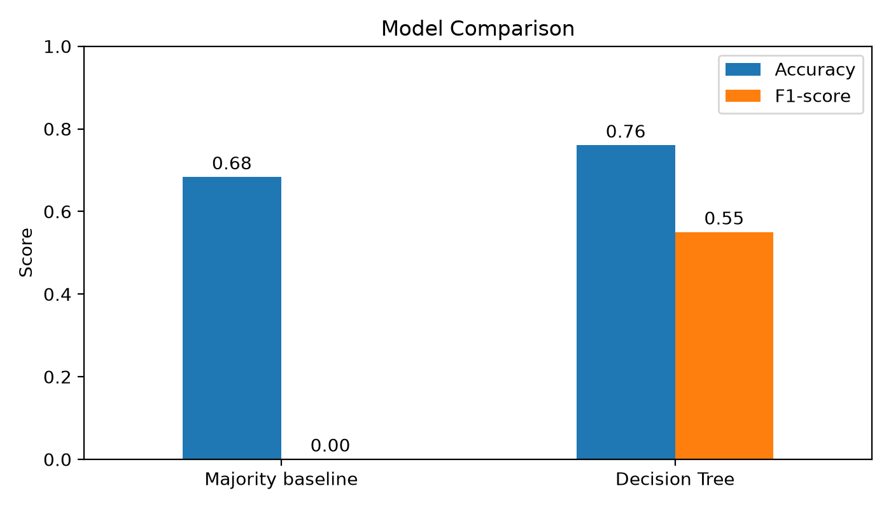
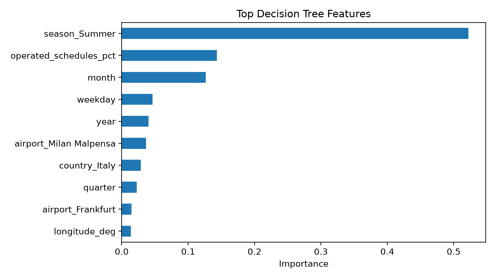
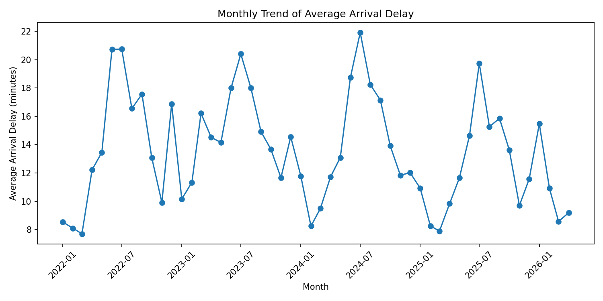

# ✈️ Flight Delay Prediction

Why are European flights late, and can we predict it? This project analyses daily punctuality data for 12 major airports in five countries and trains a model to flag days with significant arrival delays.


**Team:** Mahdi Al Shaikh · Mohammad Humidan · Mais Dar Al Deek (Birzeit University)

## Data

- **Source:** EUROCONTROL airport punctuality data for France, Germany, Italy, Spain and Sweden, joined with airport metadata.
- **Airports:** Paris CDG, Paris Orly, Nice, Frankfurt, Munich, Düsseldorf, Rome Fiumicino, Milan Malpensa, Madrid Barajas, Barcelona, Palma de Mallorca, Stockholm Arlanda.
- **Period:** January 2022 to April 2026, about 18,900 airport-day records after cleaning.
- **Target:** a day counts as *delayed* when the average arrival delay is **15 minutes or more** (`target_delayed`).

## Results

A decision tree (`max_depth=6`, `min_samples_leaf=40`) on a stratified 80/20 split, compared with always predicting "not delayed":

| Model | Accuracy | Precision | Recall | F1 |
|---|---|---|---|---|
| Majority baseline | 0.683 | 0.000 | 0.000 | 0.000 |
| **Decision tree** | **0.760** | **0.678** | **0.463** | **0.550** |

The tree beats the baseline by about 8 accuracy points and catches nearly half of the delayed days.



### What drives delays

**Summer** is by far the strongest signal (≈52% of the tree's feature importance), followed by the share of scheduled flights actually operated, the month and the weekday.





## Project structure

```
data/                     raw EUROCONTROL files and the cleaned dataset
notebooks/                phase 1 (setup) and phase 3 (exploratory analysis)
figures/                  charts from the exploratory analysis
report/                   phase 3 analysis report (PDF / DOCX)
Phase4/phase4_project/    modelling notebook, figures, results and final report
```

## Run it

```bash
pip install pandas numpy matplotlib seaborn scikit-learn openpyxl jupyter
jupyter notebook
```

Open `notebooks/phase3_data_analysis.ipynb` for the analysis, then `Phase4/phase4_project/notebooks/phase4_modeling.ipynb` for the model.
